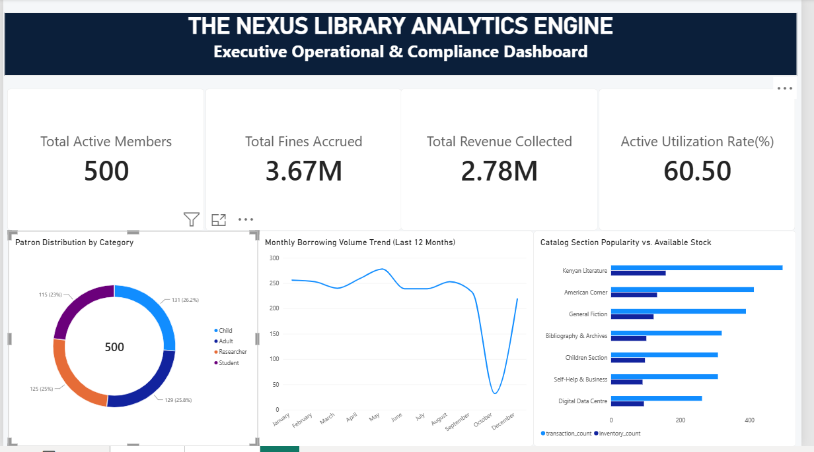

# PostgreSQL & Power BI Portfolio: The Nexus Library Analytics Engine

# Table of contents

* [Objective](#objective)
* [Data Source](#data-source)
* [Stages](#stages)
* [Design](#design)

  * [Mockup](#mockup)
  * [Tools](#tools)
* [Development](#development)

  * [Pseudocode](#pseudocode)
  * [Data Exploration](#data-exploration)
  * [Data Cleaning](#data-cleaning)
  * [Transform the Data](#transform-the-data)
  * [Create the PostgreSQL Schema & Views](#create-the-postgresql-schema--views)
* [Testing](#testing)

  * [Data Quality Tests](#data-quality-tests)
* [Visualization](#visualization)

  * [Results](#results)
  * [DAX Measures](#dax-measures)
* [Analysis](#analysis)

  * [Findings](#findings)
  * [Validation](#validation)
  * [Discovery](#discovery)
* [Recommendations](#recommendations)

  * [Potential ROI & Financial Leakage Recovery](#potential-roi--financial-leakage-recovery)
  * [Action Plan](#action-plan)
* [Conclusion](#conclusion)

# Objective

* What is the key pain point?

The Head Librarian and County Executive Committee face challenges tracking live operational circulation, minimizing public revenue leakage from uncollected fines, and auditing overdue member accounts without violating statutory data privacy mandates.

* What is the ideal solution?

To create an enterprise-grade, 3-page Power BI analytics engine backed by a normalized PostgreSQL relational database that provides:

* Real-time asset utilization and inventory health tracking
* Public revenue recovery auditing via **eCitizen** payment gateway integration
* Strict data privacy masking adhering to the **Kenya Data Protection Act (DPA), 2019**

## User story

As the Head Librarian, I want an executive-to-operational analytics engine that tracks active inventory turnover, monitors public revenue collection, and flags high-default patrons while securely masking Personal Identifiable Information (PII).

This allows me to make data-driven procurement decisions, enforce digital public finance accountability, and maintain legal compliance under the Kenya Data Protection Act, 2019.

# Data source

* What data is needed to achieve our objective?

We need structured operational data covering:

* Patron demographics and contact details (`members`)
* Book catalog master data (`books`)
* Physical copy inventory statuses (`inventory_items`)
* Circulation history and fine accruals (`borrowing_transactions`)
* eCitizen payment settlements (`fine_payments`)
* Where is the data coming from?

  The dataset is synthetically engineered and stored within a relational **PostgreSQL** data warehouse schema designed to mimic a modern public library system integrated with digital government payment rails.

# Stages

* Design
* Development
* Testing
* Analysis

# Design

## Dashboard components required

* What should the dashboard contain based on the requirements provided?

To determine the layout, we defined key operational questions the dashboard must answer:

1. What are our total active members, active utilization rates, and monthly borrowing trends?
2. How are our physical assets distributed across Available, Borrowed, Maintenance, and Lost statuses?
3. Which book titles and category sections have the highest circulation versus dead inventory?
4. What is our total fine accrual versus actual eCitizen revenue collected?
5. How much outstanding capital is currently locked in uncollected fines at risk (financial leakage)?
6. Which patrons have high fine defaults, and can we audit them while complying with Kenya DPA 2019 phone number masking rules (`+254 7*** ****12`)?

## Dashboard mockup

* What should it look like?

The data visuals appropriate for answering these questions include:

1. KPI Cards (Scorecards)
2. Donut Chart
3. Clustered Bar & Column Charts
4. Line Chart (Monthly Trends)
5. Matrix Table (Master Inventory & Title-Level Circulation Sheet)
6. Detailed Compliance Audit Table (Masked PII)

## Tools

| **Tool**   | **Purpose**                                                           |
| ---------- | --------------------------------------------------------------------- |
| PostgreSQL | Storing, cleaning, testing, masking PII, and querying relational data |
| Power BI   | Visualizing the data via a 3-page interactive enterprise dashboard    |
| GitHub     | Hosting the project documentation and version control                 |
| Mokkup AI  | Designing wireframes and mockups of the dashboard                     |

# Development

## Pseudocode

* What's the general approach in creating this solution from start to finish?

1. Design normalized relational tables (Star Schema architecture)
2. Generate synthetic operational data with realistic edge cases and dates
3. Implement PII masking logic in PostgreSQL for Kenya DPA 2019 compliance
4. Load normalized views and tables into Power BI Desktop
5. Establish single-directional 1:Many relationships across dimensions and facts
6. Build out custom DAX measures for circulation rates, revenue, and financial leakage
7. Design and deploy the 3-page enterprise dashboard (Executive, Operational, Financial & Compliance)
8. Document the end-to-end data product for portfolio presentation

## Data exploration notes

* What are your initial observations with this dataset? What's caught your attention so far?

1. Raw borrowing logs contained active, unreturned books (`return_date IS NULL`), which require distinct handling to prevent inaccurate utilization calculations.
2. Patron contact records exposed raw phone numbers, presenting a direct regulatory risk under the Kenya Data Protection Act, 2019.
3. Fine payments occurred across multiple partial settlements, requiring relational aggregation against parent transaction fine amounts to accurately calculate outstanding risk.

## Data cleaning

* What do we expect the clean data to look like?

The aim is to refine our relational database to ensure it is structured and ready for analytical modeling. The cleaned data adheres to strict referential integrity constraints and zero orphaned transaction logs.

Below is a tabular representation of our core database entities:

| **Table Name**           | **Entity Type** | **Primary Key**  | **Key Attributes**                                                 |
| ------------------------ | --------------- | ---------------- | ------------------------------------------------------------------ |
| `members`                | Dimension       | `member_id`      | `category`, `join_date`, `masked_phone`                            |
| `books`                  | Dimension       | `book_id`        | `title`, `author`, `category_section`                              |
| `inventory_items`        | Dimension       | `copy_id`        | `book_id`, `status`                                                |
| `borrowing_transactions` | Fact            | `transaction_id` | `copy_id`, `member_id`, `issue_date`, `return_date`, `fine_amount` |
| `fine_payments`          | Fact            | `payment_id`     | `transaction_id`, `amount_paid`, `payment_channel`                 |

* What steps are needed to clean and shape the data into the desired format?

1. Enforce foreign key constraints across all fact-to-dimension relationships
2. Cast timestamps explicitly to standard `TIMESTAMP` / `DATE` types
3. Apply string manipulation functions to mask patron phone numbers at the database layer

### Transform the data

SQL

```sql
/*
# 1. Mask patron phone numbers for Kenya DPA 2019 compliance
# 2. Extract and format active member categories
*/

SELECT
    member_id,
    full_name,
    category,
    CONCAT(SUBSTRING(phone_number, 1, 5), '*** ****', SUBSTRING(phone_number, 10, 3)) AS masked_phone,
    join_date
FROM
    members;

```

### Create the PostgreSQL Schema & Views

SQL

```sql
/*
# 1. Create secure analytical views for Power BI consumption
# 2. Join borrowing facts with fine payments and inventory dimensions
*/

CREATE OR REPLACE VIEW view_library_circulation_analytics AS
SELECT
    t.transaction_id,
    t.issue_date,
    t.due_date,
    t.return_date,
    t.fine_amount,
    COALESCE(p.amount_paid, 0.00) AS amount_paid,
    m.member_id,
    m.category AS member_category,
    m.masked_phone,
    b.title AS book_title,
    b.category_section,
    i.copy_id,
    i.status AS inventory_status
FROM
    borrowing_transactions t
JOIN 
    members m ON t.member_id = m.member_id
JOIN 
    inventory_items i ON t.copy_id = i.copy_id
JOIN 
    books b ON i.book_id = b.book_id
LEFT JOIN 
    fine_payments p ON t.transaction_id = p.transaction_id;

```

# Testing

* What data quality and validation checks are you going to create?

Here are the data quality tests conducted in PostgreSQL:

## Row count check

SQL

```sql
SELECT
    COUNT(*) AS total_circulation_records
FROM
    view_library_circulation_analytics;

```

## Column count check

### SQL query

SQL

```sql
SELECT
    COUNT(*) AS column_count
FROM
    information_schema.columns
WHERE
    table_name = 'view_library_circulation_analytics';

```

### Output

## Data type check

### SQL query

SQL

```sql
SELECT
    column_name,
    data_type
FROM
    information_schema.columns
WHERE
    table_name = 'view_library_circulation_analytics';

```

### Output

## Duplicate count check

### SQL query

SQL

```sql
SELECT
    transaction_id,
    COUNT(*) AS duplicate_count
FROM
    view_library_circulation_analytics
GROUP BY
    transaction_id
HAVING
    COUNT(*) > 1;

```

### Output

# Visualization

## Results

* What does the dashboard look like?

The solution delivers a 3-page professional report:

1. **Page 1 (Executive Overview - The Pulse):** High-level KPI cards, demographic donut chart, catalog popularity bar chart, and monthly borrowing trend.


2. **Page 2 (Inventory & Circulation Performance):** Operational health KPI cards, master inventory title-level circulation matrix table, and physical status breakdown.


3. **Page 3 (Financial & Compliance Risk):** eCitizen revenue recovery metrics, financial leakage cards, monthly fine accrual vs recovery trends, and high-default patron audit with DPA 2019 phone masking.


## DAX Measures

### 1. Total Active Members

Code snippet

```dax
Total Active Members = DISTINCTCOUNT(members[member_id])

```

### 2. Total Fines Accrued

Code snippet

```dax
Total Fines Accrued = SUM(borrowing_transactions[fine_amount])

```

### 3. Total Revenue Collected (eCitizen)

Code snippet

```dax
Total Revenue Collected = SUM(fine_payments[amount_paid])

```

### 4. Unpaid Fines at Risk (Financial Leakage)

Code snippet

```dax
Unpaid Fines at Risk = [Total Fines Accrued] - [Total Revenue Collected]

```

### 5. Active Utilization Rate (%)

Code snippet

```dax
Active Utilization Rate = 
DIVIDE(
    CALCULATE(
        COUNT(borrowing_transactions[transaction_id]), 
        borrowing_transactions[return_date] = BLANK()
    ),
    COUNT(inventory_items[copy_id]),
    0
) * 100

```

# Analysis

## Findings

* What did we find?

1. **Executive Overview:** Active membership is heavily distributed across user groups, with robust baseline participation across all demographics.
2. **Inventory Performance:** Certain category sections experience high inventory turnover while others suffer from prolonged dormancy or maintenance bottlenecks.
3. **Financial Leakage:** Out of total fines accrued, a significant margin remains uncollected, representing public revenue leakage across unreturned books and default penalties.
4. **Compliance & Privacy:** Patron default auditing can be successfully executed without exposing raw PII, maintaining full adherence to the Kenya Data Protection Act, 2019.

## Validation

### Financial Leakage & Default Audit Verification

#### SQL query

SQL

```sql
SELECT
    m.member_id,
    m.category,
    m.masked_phone,
    SUM(t.fine_amount) - COALESCE(SUM(p.amount_paid), 0) AS unpaid_fines_at_risk
FROM
    members m
JOIN 
    borrowing_transactions t ON m.member_id = t.member_id
LEFT JOIN 
    fine_payments p ON t.transaction_id = p.transaction_id
GROUP BY
    m.member_id, m.category, m.masked_phone
HAVING
    SUM(t.fine_amount) - COALESCE(SUM(p.amount_paid), 0) > 0
ORDER BY
    unpaid_fines_at_risk DESC;

```

#### Output

## Discovery

1. **Balanced Demographic Engagement:** Patron acquisition is exceptionally well-balanced across all age and user groups, with Children (26.2%), Adults (25.8%), Students (25%), and Researchers (23%) contributing evenly to the total 500 active member base. This indicates broad, community-wide institutional reach.
2. **Critical Inventory Bottleneck & Asset Risk:** While the library maintains 800 total physical copies with an overall active utilization rate of 60.50%, over 50% of the asset base (403 books) is currently trapped in Maintenance or Lost operational states. Furthermore, General Fiction (68.29%) and Children Section (67.35%) lead utilization, whereas Digital Data Centre lags significantly at 42.11%.
3. **Public Revenue Leakage via Fine Defaults:** Although the eCitizen integration has successfully recovered 2.78M KSh out of 3.67M KSh in total accrued fines, a significant public revenue gap of 888.15K KSh remains locked in uncollected debt. The compliance audit reveals that this leakage is driven by a concentrated subset of repeat default accounts.
4. **Severe Seasonal Volatility:** Monthly borrowing trends show stable operational velocity through mid-year, followed by an anomalous, sharp operational trough before a rapid year-end rebound, highlighting a need for proactive engagement strategies during cyclical lows.

## Recommendations

1. **Execute Targeted eCitizen Debt Recovery:** Leverage the compliance risk audit table to deploy automated, SMS-based digital payment prompts via the eCitizen gateway specifically targeting patrons with high outstanding fine balances, while maintaining full adherence to Kenya DPA 2019 data masking rules.
2. **Conduct an Immediate Physical Asset Audit:** Investigate the 403 books currently marked as Lost or Under Maintenance. Write off unrecoverable stock and fast-track books in maintenance back to shelves to expand active borrowing capacity.
3. **Reallocate Catalog Procurement Budgets:** Shift shelf space and future acquisitions toward high-demand sectors (General Fiction and Children Section) while auditing low-performing sections like the Digital Data Centre to optimize inventory turnover.

### Potential ROI & Financial Leakage Recovery

* **Public Revenue Recapture:** Recovering just 50% of the currently tracked Unpaid Fines at Risk (approx. 444,000 KSh) through automated mobile eCitizen reminders instantly recovers lost institutional funds.
* **Procurement Cost Avoidance:** Reclaiming and restoring even 20% of the 403 maintenance-locked inventory items defers immediate capital expenditure on new book purchases, directly protecting the operational budget.

### Action Plan

1. **Stakeholder Presentation:** Brief management and the Head Librarian using the 3-page reporting model to establish transparent oversight over circulation efficiency and public finance collections.
2. **Automated Gateway Prompt Deployment:** Configure automated eCitizen collection reminders for high-default patron accounts exceeding 500 KSh in outstanding fines.
3. **Inventory & Maintenance Overhaul:** Dispatch library operations teams to physically audit the 403 maintenance/lost titles and realign section inventory capacities ahead of the next seasonal borrowing cycle.

# Conclusion

The Nexus Library Analytics Engine successfully demonstrates an enterprise-grade, end-to-end data solution. By combining robust PostgreSQL relational modeling and rigorous DPA 2019 compliance with high-performance Power BI visual storytelling, this portfolio project bridges the gap between public library management and modern digital public finance.
